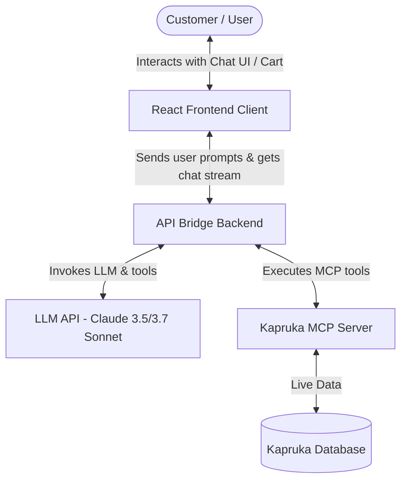
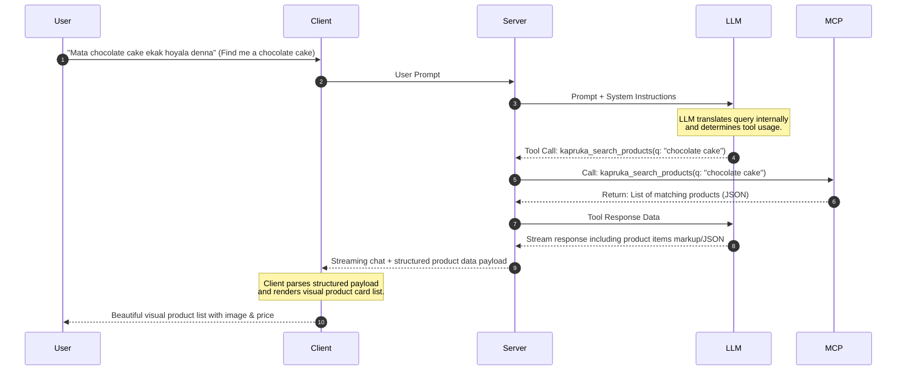
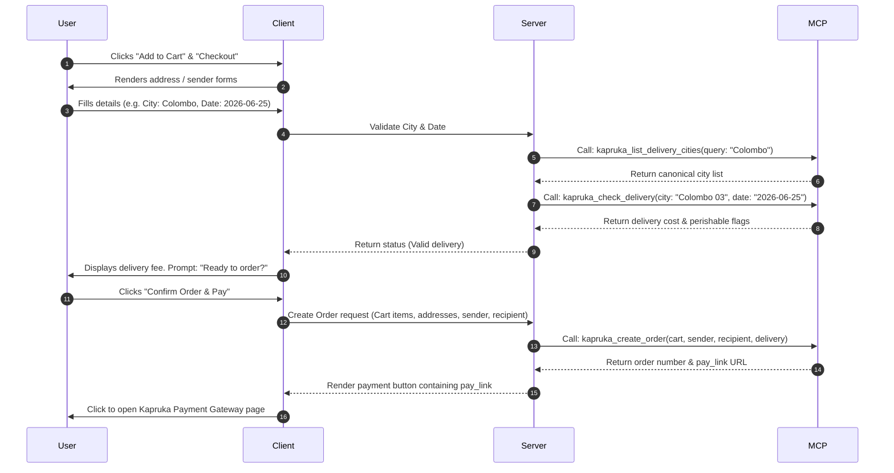

# System Architecture & Data Flow

This document details the high-level system architecture, component structures, and data flows of the Kapruka AI Shopping Agent.

---

## 🏗️ System Overview

The system consists of three main components:
1.  **Frontend Client:** A React-based Single Page Application (SPA) that renders the full-screen chat UI, manages the shopping cart state, displays product cards, and handles payment links.
2.  **API Gateway/Bridge Server:** An intermediate Node/Express backend that orchestrates the connection to the remote Kapruka MCP server and proxies calls. It keeps API logic secure and handles rate limits.
3.  **Kapruka MCP Server:** The live, remote Model Context Protocol endpoint hosting the product catalog, shipping network, and order processing capabilities.

---

## 🔄 Sequence of Key Workflows

### 🔍 1. Product Search & Discovery

### 🛒 2. Checkout & Order Placement

---

## 🎨 Frontend Component Architecture
The client application is split into specialized, modular components:
1.  **`ChatPanel`:** Handles message history rendering, streaming status indicator, voice/text input box, and prompt suggestion chips.
2.  **`CartDrawer`:** Side panel displaying current cart items, quantities, and pricing calculations.
3.  **`ProductCard` / `ProductCarousel`:** Highly visual containers rendering item images, price tags, and add-to-cart actions.
4.  **`CheckoutForm`:** Wizard forms prompting the user step-by-step for delivery details without cluttering the chat view.
5.  **`OrderTracker`:** Dynamic search widget to let customers search and check shipping progress using `kapruka_track_order`.
