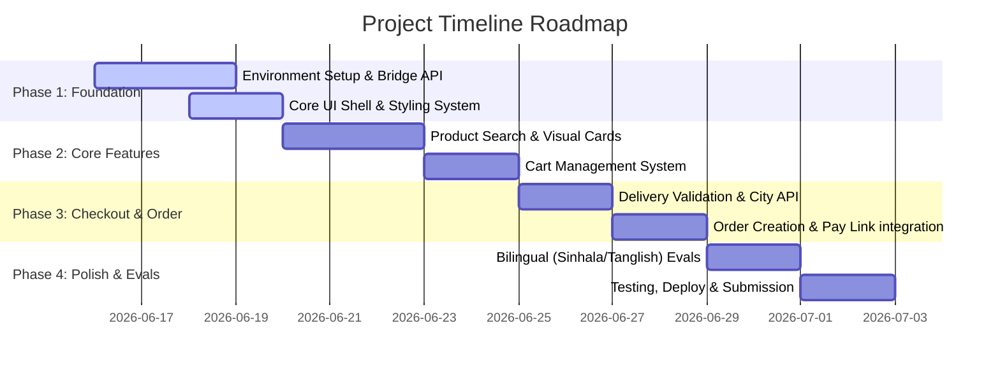

# Kapruka Agent Challenge - Project Execution Plan

This document establishes the project roadmap, technology stack, milestones, and development plan for building the AI Shopping Agent.

---

## 🛠️ Proposed Tech Stack

To meet the high standards of the Kapruka Agent Challenge (Experience, Polish, Visual Richness, and responsiveness), the following stack is proposed:

*   **Frontend Framework:** React (Vite-powered for rapid hot reloading and optimized production build) or Next.js.
*   **Styling System:** Tailwind CSS for component-based styles with high responsiveness, supplemented by Vanilla CSS for custom micro-animations (e.g. typing animations, float effects).
*   **UI Component Library:** Radix UI / shadcn/ui (for accessible dialogs, carousels, sheet drawers, calendar date pickers).
*   **Icons:** Lucide-react for clean, modern icon representations.
*   **AI Integration Orchestrator:** 
    *   Vercel AI SDK or LangChain.js to handle streaming chat responses.
    *   Custom Server-Side API endpoint (e.g., Express or Next.js API route) to securely bridge the client to the Kapruka MCP Server.
*   **LLM Model:** Anthropic Claude 3.5 Sonnet / Claude 3.7 Sonnet (excellent at tool usage, planning, and Sinhala/Tanglish bilingual reasoning).

---

## 📅 Milestones & Phases

### 🏁 Phase 1: Core Setup & Bridge API (Milestone 1)
*   **Task 1.1:** Initialize the Vite + React codebase.
*   **Task 1.2:** Implement the backend server bridge to connect to the SSE-based Kapruka MCP server at `https://mcp.kapruka.com/mcp`.
*   **Task 1.3:** Setup the design token system, fonts (Inter/Outfit), and theme colors based on Kapruka's brand guidelines (Deep Purple `#402970`, Accent Yellow `#f8da08`).
*   **Task 1.4:** Create a responsive, full-screen chat interface structure.

### 🛍️ Phase 2: Visual Discovery & Cart State (Milestone 2)
*   **Task 2.1:** Enable streaming LLM interface with tool-calling capabilities.
*   **Task 2.2:** Build rich UI components for product rendering (Image sliders, price indicators, stock badges, hover details).
*   **Task 2.3:** Implement a local-state shopping cart (adding, updating quantities, removing items) synced with the chat side-panel.

### 💳 Phase 3: Checkout Loop & Validation (Milestone 3)
*   **Task 3.1:** Connect `kapruka_list_delivery_cities` and build an autocomplete search bar for shipping addresses.
*   **Task 3.2:** Connect `kapruka_check_delivery` to validate shipping dates, calculate fees, and flag perishable goods.
*   **Task 3.3:** Design the guest checkout checkout forms (sender/recipient details) and render the click-to-pay button linking directly to the locked order checkout page.

### 🇵🇱 Phase 4: Polish, Language & Deployment (Milestone 4)
*   **Task 4.1:** Polish systemic UX micro-animations, loading skeletons, and interactive state transitions.
*   **Task 4.2:** Integrate System Prompts prompting the LLM to manage Sinhala-to-English translation and Tanglish search routing.
*   **Task 4.3:** Set up a live deployment (e.g., Vercel, Netlify) with active monitoring to ensure a 100% uptime public link.
